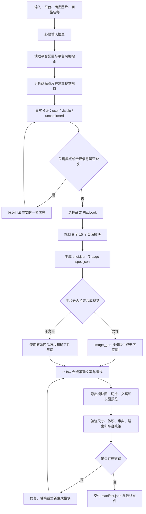

# E-commerce Detail Page Generator

面向 Codex 的多平台电商详情页生成 Skill。它可以从少量商品资料出发，完成商品事实审查、平台规则匹配、页面叙事策划、分模块视觉生成、确定性文字排版、图片切片、长图预览与自动质量验证。

它不是一个只负责“生成好看图片”的提示词模板，而是一套强调商品真实性、平台适配和可交付文件的完整生产工作流。

## 项目定位

用户只需提供三个必要输入：

1. 目标平台及站点或国家。
2. 至少一张清晰的商品图片。
3. 商品名称或品类。

Skill 会根据商品和平台选择 6 至 10 个详情页模块，并输出适合审核、修改和上传的结构化项目文件。

核心能力包括：

- 多平台路由：根据平台自动切换画布尺寸、模块结构、信息密度、文案节奏和图片政策。
- 商品事实保护：将信息划分为用户提供、图片可见和未经确认三类，禁止发布未经确认的卖点。
- 商品视觉分析：识别主色、造型、表面质感、视觉温度、价格感和摄影语言。
- 页面故事策划：按照首屏、痛点、核心差异、功能细节、使用场景、操作说明、规格和收尾组织内容。
- 分模块 AI 生图：每个模块单独生成无文字视觉底图，避免一次生成整张长图造成文字错误和产品漂移。
- 确定性排版：使用 Pillow 写入准确文案，控制字体、字号、边距、换行、圆角、图片裁切和输出尺寸。
- 多形态导出：支持长图切片、图库卡片、Amazon A+ 模块、品牌页面区块和审核用长图。
- 自动验证：检查事实引用、平台限制、图片尺寸、文件体积、文字溢出、模块缺失和预览限制。

## 运作路径



## 生图方式

视觉生成采用“AI 生成视觉底图，代码负责最终排版”的双阶段方式。

### 1. AI 只生成无文字底图

Codex 加载系统 `imagegen` Skill，并通过内置 `image_gen` 工具为需要新视觉的模块分别生成底图。Hero、功能特写、生活方式、操作步骤和 Closing 等模块会使用不同的提示词配方。

每次生成都会重复商品锁定约束：

- 保持商品轮廓、比例、颜色、表面、开口、按钮、标签和 Logo 位置。
- 不虚构未展示的背面、内部结构、附件、包装或使用结果。
- 不生成文字、数字、徽章、水印、UI 或认证标识。
- 根据后续版式预留明确的文字负空间。
- 单视角素材不进行大幅旋转，避免生成未知表面。

项目中的 Python 脚本不会自行调用外部生图 API。AI 图像生成由 Codex Agent 在工作流中编排，生成后的图片路径再写入 `page-spec.json`。

### 2. Pillow 完成确定性合成

`scripts/compose_detail_page.py` 负责：

- 读取 `page-spec.json` 和可选的 `brief.json`。
- 按指定尺寸裁切或填充视觉底图。
- 写入准确、可复现的中英文文案。
- 自动换行、缩放字号并检测文字溢出。
- 应用色板、圆角、遮罩、渐变和模块布局。
- 按平台要求控制 JPG/PNG 格式、压缩质量和文件体积。
- 生成独立模块图、长图预览、文案文件和交付清单。

这种分工避免让生成模型直接绘制商品文案，也使尺寸、文字和导出结果可以被程序验证。

## 支持平台

| 平台 | 默认输出模式 | 工作宽度 | AI 视觉策略 |
| --- | --- | ---: | --- |
| 淘宝 / 天猫 | 长图切片 | 750 px | 在准确还原商品的前提下允许 |
| 京东 | 长图切片 | 750 px | 在准确还原商品的前提下允许 |
| 拼多多 | 长图切片 | 750 px | 在准确还原商品的前提下允许 |
| 抖音电商 | 长图切片 | 750 px | 详情页可使用，首张主图需遵守真实商品图规则 |
| 小红书电商 | 图库与长图预览 | 1242 px | 在准确还原商品的前提下允许 |
| Amazon | A+ 模块 | 970 px | A+ 内容可使用，需匹配所选模板 |
| AliExpress | 长图切片 | 960 px | 详情页可使用 |
| Temu | 图库卡片 | 1200 px | 需在当前商家后台确认 |
| TikTok Shop | 真实商品图库 | 1200 px | 上传用图片禁止数字渲染和附加文字 |
| eBay | 图库卡片 | 1600 px | 优先使用真实商品照片 |
| Etsy | 原始商品照片图库 | 2000 px | 上传用图片必须使用卖家实际商品照片 |
| Shopify | 品牌页面区块 | 1536 px | 在准确还原商品的前提下允许 |

平台资料位于 `references/platform-profiles.json`。配置包含别名、语言、导出模式、画布宽度、文件格式、体积限制、图片文字政策、AI 视觉政策、推荐模块和规则证据等级。

当规则过期、平台未覆盖、规则要求商家后台确认，或商品属于医疗、儿童、食品、美妆功效、电池和安全敏感类目时，工作流会要求重新核验当前官方规则。

## 商品事实与合规机制

每项商品信息都必须标注来源：

| 来源 | 含义 | 是否可发布 |
| --- | --- | --- |
| `user` | 用户明确提供的信息 | 可以 |
| `visible` | 可从商品图片直接观察的信息 | 可以 |
| `unconfirmed` | 合理猜测但没有证据的信息 | 不可以 |

系统不会根据外观推断隐藏材质、尺寸、容量、性能、认证、兼容性、成分、医疗效果、价格、折扣、销量、评价、质保、包装内容或未展示的商品表面。

每个页面模块还必须声明自己引用了哪些事实。合成器和验证器会拒绝引用未确认事实的模块。

## 页面结构

默认页面故事由以下阶段组成：

1. 商品主视觉与核心承诺。
2. 用户问题或目标状态。
3. 主要差异点。
4. 功能、结构或工艺细节。
5. 真实使用场景。
6. 操作、适配或尺寸说明。
7. 已确认的规格和包装信息。
8. 信任信息、护理说明或总结收尾。

项目内置 3C 数码、美妆个护、服饰配件、家居厨房、食品饮料、宠物用品、手工礼品和高风险品类 Playbook。没有证据时，系统会主动省略对比、认证、评价、保证、折扣和使用前后效果模块。

## 输出文件

一次完整执行会生成：

```text
ecommerce-detail-output/<product-slug>/
├── brief.json
├── page-spec.json
├── copy.md
├── modules/
│   ├── 01-hero.jpg
│   ├── 02-benefit.jpg
│   └── ...
├── detail-page-long.jpg
└── manifest.json
```

- `brief.json`：商品分析、视觉指纹、事实分类、风险和设计方向。
- `page-spec.json`：平台、样式、模块、文案、图片和事实引用的完整生产规范。
- `copy.md`：可独立审核和修改的页面文案。
- `modules/`：平台上传或后续编辑使用的独立模块图。
- `detail-page-long.jpg`：整页审核预览；部分平台仅作为预览，不作为上传文件。
- `manifest.json`：模块清单、尺寸、状态、警告、预览限制和待确认规则。

## 安装

### 作为 Codex Skill 安装

```bash
git clone https://github.com/Gayaya999/ecommerce-detail-page-generator.git \
  ~/.codex/skills/ecommerce-detail-page-generator
```

重新启动 Codex 后，可通过 `$ecommerce-detail-page-generator` 显式调用，也可以在提出电商详情页相关需求时隐式触发。

### 安装本地合成依赖

```bash
cd ~/.codex/skills/ecommerce-detail-page-generator
python3 -m pip install -r requirements.txt
```

建议使用 Python 3.10 或更高版本。

## 使用方式

向 Codex 提供平台、商品图片和商品名称，例如：

```text
使用 $ecommerce-detail-page-generator
平台：Amazon US
商品：便携式榨汁杯
商品图片：/absolute/path/to/product.jpg
```

当图片底图和 `page-spec.json` 准备完成后，也可以单独运行合成器：

```bash
python3 scripts/compose_detail_page.py \
  --spec /path/to/page-spec.json \
  --brief /path/to/brief.json \
  --output /path/to/ecommerce-detail-output/product-slug
```

执行验证：

```bash
python3 scripts/validate_output.py \
  --spec /path/to/page-spec.json \
  --output /path/to/ecommerce-detail-output/product-slug
```

运行四平台隔离回归测试：

```bash
python3 scripts/test_pipeline.py
```

## 项目结构

```text
.
├── SKILL.md
├── agents/
│   └── openai.yaml
├── references/
│   ├── category-playbooks.md
│   ├── page-spec.schema.json
│   ├── platform-profiles.json
│   ├── platform-style-guide.md
│   └── prompt-recipes.md
├── scripts/
│   ├── compose_detail_page.py
│   ├── validate_output.py
│   └── test_pipeline.py
├── requirements.txt
└── LICENSE
```

## 质量验收

以下情况会触发报错、警告、替换或重新生成：

- 商品形状、颜色、Logo、按钮或可见配件发生漂移。
- 文案超出安全区域、字号过小或产生溢出。
- 相邻模块构图重复，页面缺少节奏变化。
- 页面看起来像与商品无关的通用模板。
- 卖点没有 `user` 或 `visible` 事实来源。
- 图片尺寸、格式或文件大小不符合平台配置。
- 平台要求真实商品照片，但模块使用了合成图。
- 模块只能用于概念预览，却被标记为可上传文件。

## 当前边界

- 本项目不会代替商家对商品信息、知识产权、广告法和平台后台规则进行最终审核。
- 平台规则会变化，带有 `seller_backend_confirmation` 标记的项目必须在当前商家后台确认。
- AI 生图质量取决于输入图片的清晰度和视角覆盖；单张图片无法可靠还原未展示区域。
- 合成器提供确定性排版和基础布局，不等同于完整的可视化拖拽编辑器。
- TikTok Shop 和 Etsy 等平台对合成图限制严格，工作流会优先使用真实商品照片。

## 开源协议

本项目使用 [MIT License](LICENSE) 开源。欢迎提交 Issue、平台规则更新和 Pull Request。
